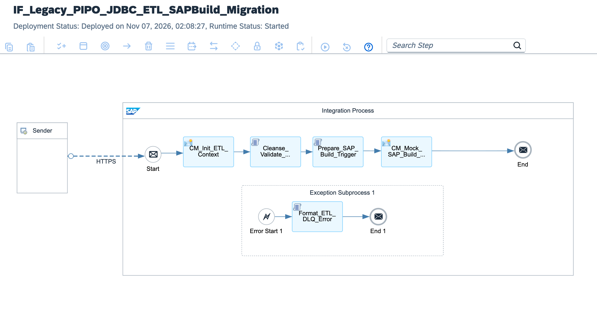

# Enterprise Legacy PI/PO Modernization: JDBC Staging ETL, Groovy In-Memory Cleansing & SAP Build Process Automation

[](https://www.sap.com)
[](https://www.sap.com)
[](https://www.sap.com)
[](https://www.sap.com)
[](https://www.sap.com)

---

## Executive Summary

Enterprises migrating away from deprecated SAP Process Orchestration (PO 7.5) frequently encounter brittle on-premises database staging tables, unmonitored SQL batch pollers, and shadow ETL pipelines that lack data quality audits. Direct unvalidated ingestion into SAP S/4HANA creates reconciliation errors, corrupted ledger records, and unplanned downtime.

This architecture delivers a **Production-Grade Clean Core ETL & Governance Pipeline**:
1. **Secure On-Premises JDBC Polling:** Replaces obsolete PI/PO JDBC sender channels with high-performance, parameterized JDBC adapters routed through SAP BTP Cloud Connector.
2. **In-Flight Groovy Cleansing & Deduplication:** Sanitizes corrupt date formats, removes surrogate duplicate keys, and computes data-quality deviation scores in RAM before persistence.
3. **Human-in-the-Loop Exception Governance:** Routes transactions exceeding financial threshold anomalies directly to **SAP Build Process Automation**, dynamically triggering enterprise approval tasks in SAP Task Center before S/4HANA commitment.
4. **Clean Core OData V4 Dispatch:** Posts approved records via standard OData V4 APIs with atomic idempotency keys, guaranteeing exactly-once transactional semantics.

---

## Architecture Overview



### High-Level Topology

```text
[Legacy On-Premises Relational Database (SQL Staging Tables)]
          │
          │ Parameterized JDBC Poll (via SAP BTP Cloud Connector)
          ▼
[SAP Integration Suite: IF_Legacy_JDBC_ETL_SAPBuild_S4HANA]
  │
  ├── 1. Context Initialization (CM_Init_ETL_Context):
  │    └─ Sets MPL tracking properties, batch IDs, and audit timestamps
  │
  ├── 2. In-Memory Sanitization (Cleanse_And_Deduplicate_Staging_Data.groovy):
  │    ├─ Strips leading whitespace, normalizes ISO date formats
  │    ├─ Detects and strips duplicate staging row identifiers
  │    └─ Evaluates deviation thresholds (Material value & Ledger variances)
  │
  ├── 3. Data Governance Router (Router_Quality_Governance):
  │    ├─ [Threshold Anomaly Detected (Variance > Limit)] ──► Trigger SAP Build Process
  │    │    ├─ Submits workflow instance via SAP Build REST API
  │    │    └─ Suspends automated ERP commit pending Business Sign-Off
  │    │
  │    └─ [Clean Data Stream (Compliant Quality Score)] ──► Continue
  │
  ├── 4. OData V4 Payload Builder (Build_S4HANA_ODataV4_Payload.groovy):
  │    └─ Assembles canonical JSON with transactional Idempotency-Key
  │
  ├── 5. Outbound S/4HANA Dispatch:
  │    └─ HTTP OData V4 Adapter (/sap/opu/odata4/sap/api_journalentry/srvd_a2x)
  │
  └── 6. Exception Subprocess (Format_ETL_DLQ.groovy):
       └─ Dumps rejected staging records with diagnostic stack trace to secure DLQ
```

---

## Technical Specifications

| Architectural Dimension | Legacy SAP PI/PO JDBC Staging | BTP Cloud Integration + SAP Build Pipeline |
| :--- | :--- | :--- |
| **Connectivity** | Static on-premise JDBC driver / dual-stack | Encrypted SAP BTP Cloud Connector tunnel |
| **Data Cleansing** | Brittle database triggers & stored procedures | High-performance Groovy in-memory normalization |
| **Error Handling** | Generic PI/PO alert inbox / failed message stuck in queues | Automated triage & Dead-Letter Queue (DLQ) with correlation |
| **Governance Layer** | Manual IT support ticket & direct DB correction | Native **SAP Build Process Automation** Human-in-the-Loop workflow |
| **ERP Integration** | Direct RFC / invasive BAPI database injection | Decoupled S/4HANA OData V4 API with idempotency |
| **Traceability** | Monolithic local message monitoring logs | End-to-end MPL tracking across BTP and SAP Task Center |

---

## SAP Build Process Automation Trigger Envelope

When staging data contains variance or financial amounts exceeding defined governance limits, the pipeline suspends direct posting and dispatches a governance task:

```json
{
  "definitionId": "eu10.build.governance.financialStagingApproval",
  "context": {
    "batchIdentifier": "ETL-BATCH-20261107-0091",
    "sourceDatabase": "LEGACY_ORACLE_FIN_STAGING",
    "varianceDetectedEUR": 142500.00,
    "discrepancyReason": "Threshold variance exceeded: Unit price delta > 15%",
    "extractedItemsCount": 420,
    "reviewUrl": "[https://fiori.enterprise.com/task-center](https://fiori.enterprise.com/task-center)",
    "payloadReferenceId": "PL-UUID-9910-44AA-8812"
  }
}
```

---

## Repository Structure

```text
├── README.md                                             # Architecture specification & operations runbook
├── sap-cpi-legacy-pipo-etl-sapbuild-runtime-architecture.png # Integration flow runtime topology diagram
├── ADR-005-Legacy-PIPO-Migration-And-ETL-Governance.md  # Architecture Decision Record
├── IF_Legacy_JDBC_ETL_SAPBuild_S4HANA.zip                # Production iFlow runtime bundle export
├── cpi/
│   └── scripts/
│       ├── Cleanse_And_Deduplicate_Staging_Data.groovy  # Data normalization & variance scoring
│       ├── Build_S4HANA_ODataV4_Payload.groovy          # OData V4 canonical payload builder
│       └── Format_ETL_DLQ.groovy                         # Staging failure & incident handler
├── tests/
│   ├── sample_valid_staging_batch.json                   # Verified compliant staging record set
│   └── sample_high_variance_anomaly_batch.json           # Anomaly payload triggering SAP Build workflow
└── .gitignore                                            # Git exclusion rules
```

---

## Verification & Deployment Runbook

### 1. Inbound Endpoint / Scheduled Poller Verification
Confirm runtime status in **Monitor** ──► **Manage Integration Content**:
```text
Artifact: IF_Legacy_JDBC_ETL_SAPBuild_S4HANA
State: Started
Component Status: Poller Active / Cloud Connector Tunneled
```

### 2. Dispatched cURL Test (Simulated Ingestion Trigger)
Execute an authorized POST request using staged test data:

```bash
curl -X POST \
  'https://<tenant-runtime>.cfapps.<region>[.hana.ondemand.com/http/legacy/etl/staging/process](https://.hana.ondemand.com/http/legacy/etl/staging/process)' \
  -H 'Content-Type: application/json' \
  -H 'Authorization: Bearer <BTP_OAUTH_TOKEN>' \
  --data-binary '@tests/sample_valid_staging_batch.json'
```

### 3. Monitoring Trace
* Inspect execution under **Monitor Message Processing**.
* Verify properties `Cleanse_Status = PASSED`, `Deduplicated_Rows_Count`, and `S4HANA_Document_Number`.
* If testing anomaly data, verify that the `SAP_Build_Instance_ID` property is created and HTTP 202 Accepted is returned.

---

## Author

**Željko Popov**  
*Integration Architect | SAP Integration Suite & Clean Core Specialist*  
[GitHub Repositories](https://github.com/neurozeljko)
